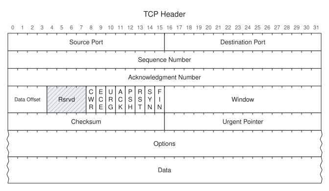

<h1 align="center">Bitgram</h1>

<p align="center">
  <strong>Packet headers, bit fields, and register maps from YAML, JSON, or Ruby.</strong><br>
  One definition. ASCII, Unicode, SVG, PNG, and JPEG.
</p>

<p align="center">
  <a href="bitgram.gemspec"></a>
  <a href="LICENSE.txt"></a>
</p>

<p align="center">
  <a href="#features">Features</a> ·
  <a href="#installation">Installation</a> ·
  <a href="#quick-start">Quick start</a> ·
  <a href="#ruby-api">Ruby API</a> ·
  <a href="#documentation">Documentation</a>
</p>

<p align="center">
  
</p>
<p align="center"><code>bitgram render --preset tcp -o tcp.svg</code></p>

## Features

- **One layout, five outputs.** Generate text for READMEs and RFC-style specifications, SVG for the web, or PNG and JPEG for documents and slides.
- **Flexible bit layouts.** Choose 1–128 bits per row, split fields across rows, merge address blocks, and represent variable-length data.
- **Readable labels.** Automatic wrapping, short names, vertical labels, and footnotes, with Unicode display widths for Japanese text.
- **Style and context.** Light, dark, monochrome, and automatic themes; field colors, reserved hatching, optional borders, and byte offsets.
- **Ready-made protocols.** Start with TCP, UDP, IPv4, IPv6, ICMP Echo, or ARP, then customize the definition.
- **Reproducible output.** Deterministic diagrams, validation with paths and YAML line numbers, and a shared rendering pipeline for the CLI and Ruby API.

## Installation

Requires **Ruby 3.3+**. Install from a source checkout:

```sh
bundle install
bundle exec rake install
```

ASCII, Unicode, and SVG use the `unicode-display_width` gem and need no native rendering tools.

<details>
<summary><strong>Optional: PNG and JPEG support</strong></summary>

Install one of these converters. Automatic selection follows the order below.

| Backend | PNG | JPEG | Requirement |
| --- | :---: | :---: | --- |
| vips | ✓ | ✓ | `ruby-vips` gem + libvips |
| rsvg | ✓ | — | `rsvg-convert` command |
| ImageMagick | ✓ | ✓ | `magick` or `convert` command |

For vips, add this to your application's Gemfile:

```ruby
gem "ruby-vips", "~> 2.3"
```

Install the native library, then run `bundle install`:

```sh
# macOS
brew install vips

# Ubuntu
sudo apt-get install libvips-dev fonts-noto-cjk
```

Run `bitgram doctor` to check converters and CJK fonts. See the [raster settings](docs/format.md#raster) for scale, background, quality, and backend selection.

</details>

## Quick start

Render a bundled preset immediately:

```sh
bitgram render --preset udp
bitgram render --preset tcp -o tcp.svg
```

<details>
<summary>See the UDP text output</summary>

```text
 0                   1                   2                   3
 0 1 2 3 4 5 6 7 8 9 0 1 2 3 4 5 6 7 8 9 0 1 2 3 4 5 6 7 8 9 0 1
+-+-+-+-+-+-+-+-+-+-+-+-+-+-+-+-+-+-+-+-+-+-+-+-+-+-+-+-+-+-+-+-+
|          Source Port          |       Destination Port        |
+-+-+-+-+-+-+-+-+-+-+-+-+-+-+-+-+-+-+-+-+-+-+-+-+-+-+-+-+-+-+-+-+
|            Length             |           Checksum            |
+-+-+-+-+-+-+-+-+-+-+-+-+-+-+-+-+-+-+-+-+-+-+-+-+-+-+-+-+-+-+-+-+
.                                                               .
.                             Data                              .
.                                                               .
+-+-+-+-+-+-+-+-+-+-+-+-+-+-+-+-+-+-+-+-+-+-+-+-+-+-+-+-+-+-+-+-+
```

</details>

To define your own diagram, save this as `udp.yml`:

```yaml
version: 1
title: UDP Header
fields:
  - { name: Source Port,      bits: 16 }
  - { name: Destination Port, bits: 16 }
  - { name: Length,           bits: 16 }
  - { name: Checksum,         bits: 16 }
  - { name: Data,             bits: variable }
```

Render it, choose a style, or validate it before generating output:

```sh
bitgram render udp.yml -o udp.svg
bitgram render udp.yml --ascii-style unicode
bitgram render udp.yml -o udp.png --scale 2  # Requires a raster converter
bitgram validate udp.yml --strict
```

Use `bitgram init ipv6 > ipv6.yml` to start from an editable preset. Browse the generated examples: [TCP](examples/tcp.svg) · [UDP](examples/udp.svg) · [IPv4](examples/ipv4.svg) · [IPv6](examples/ipv6.svg) · [ICMP](examples/icmp.svg) · [ARP](examples/arp.svg).

## Ruby API

Load a file, a YAML/JSON string, a Hash, or a bundled preset:

```ruby
require "bitgram"

diagram = Bitgram.load_file("udp.yml")
puts diagram.to_ascii(style: :unicode)
diagram.save("udp.svg", theme: "dark")
diagram.save("udp.jpg", scale: 2, quality: 85) # Requires a raster converter
```

Or describe a register directly in Ruby:

```ruby
register = Bitgram.define(title: "CTRL") do
  row_bits 16
  bit_order :lsb0
  field "EN", bits: 1, description: "Enable"
  field "MODE", bits: 3
  reserved 4
  field "DIV", bits: 8
end

puts register.to_ascii
```

The [Ruby API guide](docs/ruby-api.md) covers Hash and string inputs, overrides, diagnostics, and access to the logical layout.

## Configuration

Set options in the definition, override them from the CLI, or pass renderer keywords in Ruby.

| Setting | Default | Purpose |
| --- | --- | --- |
| `layout.row_bits` | `32` | Bits per row, from 1 to 128 |
| `layout.bit_order` | `msb0` | Number bits from the left or use `lsb0` from the right |
| `layout.offsets` | `none` | Show decimal or hexadecimal byte offsets |
| `ascii.style` | `rfc` | Choose RFC-style or Unicode borders |
| `svg.theme` | `default` | Use `default`, `mono`, `dark`, `auto`, or a theme file |
| `raster.scale` | `2` | Scale PNG/JPEG output |

```sh
bitgram render --preset tcp --theme dark --set layout.offsets=hex -o tcp.svg
```

Fields also support `bytes`, `short`, `value`, `reserved`, `optional`, and `fill`. See the [complete format reference](docs/format.md) and [JSON Schema](schema/bitgram.schema.json) for all settings and editor completion.

## Documentation

| Guide | What's inside |
| --- | --- |
| [Definition format](docs/format.md) | Fields, layout, themes, fitting strategies, and limits |
| [CLI reference](docs/cli.md) | Commands, options, stdin, validation, and exit codes |
| [Ruby API](docs/ruby-api.md) | Loading, rendering, DSL, diagnostics, and layout inspection |
| [Protocol presets](docs/presets.md) | Bundled definitions and their RFC sources |
| [Development](docs/development.md) | Tests, golden files, benchmarks, and implementation decisions |
| [Releasing](docs/releasing.md) | Packaging and Trusted Publishing setup |

<details>
<summary><strong>Rendering notes and input limits</strong></summary>

- Unicode borders assume ambiguous-width characters occupy one column. If your terminal displays them as two, use RFC style or adjust the terminal setting.
- PNG/JPEG use installed fonts. Japanese labels need a CJK font such as Noto Sans CJK JP; `bitgram doctor` checks fontconfig when available.
- SVG text widths are estimated. Increase `svg.char_width_ratio` or choose a monospace font if labels extend beyond their cells.
- YAML aliases and object tags are rejected. Input strings and files are limited to 1 MiB, definitions to 10,000 fields and 4,096 logical rows, and raster output to 50 million pixels. Definitions never cause network requests.

</details>

## Development

```sh
bundle install
bundle exec rake          # RSpec + RuboCop
bundle exec yard doc
```

Run `RASTER=0 bundle exec rake examples` to regenerate text and SVG examples. To include PNG, install a converter and run `bundle exec rake examples`.

For all raster backends, enable the optional bundle with `BUNDLE_WITH=raster bundle install`, then run `BUNDLE_WITH=raster REQUIRE_RASTER=1 bundle exec rake`. See the [development guide](docs/development.md) for prerequisites and verification details.

## License

Released under the [MIT License](LICENSE.txt).
